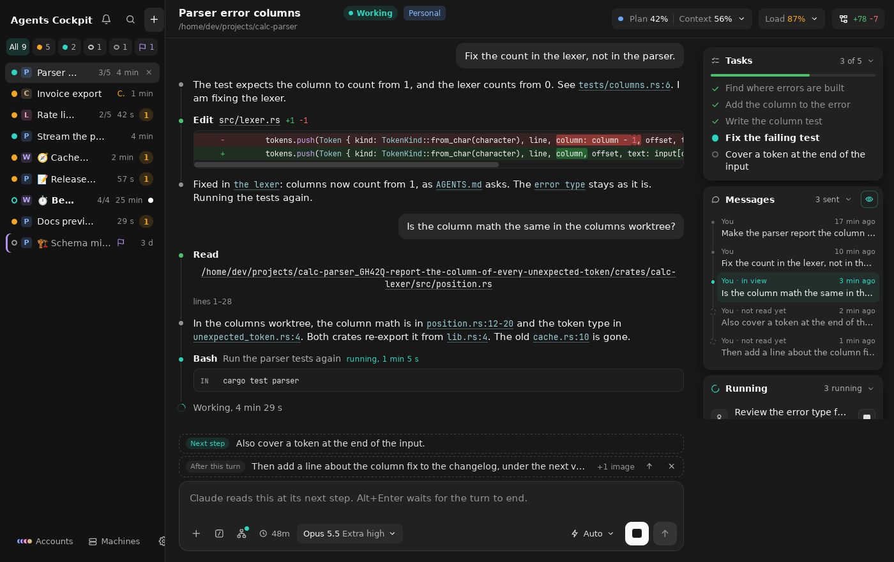

# agents-cockpit

Run several Claude Code agents, on your computer or on a server, and watch and steer them from one desktop app: their conversations, tool calls, approvals, questions and plans.



- The agents run in a daemon, so they keep working when the app closes or the laptop sleeps.
- The app reaches a server over SSH, with your SSH key. The daemon opens no network port.
- Claude Code runs unmodified, signed in with your own account. The app never sees your credentials.

Status: early. The first users are colleagues of the author, on Linux and Windows.

## Install

Download the files from the [releases page](https://github.com/Henauxg/agents-cockpit/releases).

| Your computer | File | How |
| --- | --- | --- |
| Ubuntu 22.04 or newer, Debian 12 | `agents-cockpit_<version>_amd64.deb` | `sudo apt install ./agents-cockpit_<version>_amd64.deb` |
| Windows 10 or 11 | `agents-cockpit-desktop-<version>-windows-x64.zip` | Unzip it anywhere and run `agents-cockpit-desktop.exe` |
| NixOS, or Linux with Nix | | `nix profile install github:Henauxg/agents-cockpit` |
| macOS, other Linux | | Build from source: [docs/development.md](docs/development.md) |

The `.deb` installs the app (`agents-cockpit-desktop`) and the daemon and command line (`agents-cockpit`).

You also need Claude Code on each machine where agents run. Install [Claude Code](https://claude.com/claude-code), then run `claude` once and sign in.

## Choose where the agents run

### Only this computer

Start the app. The first time, it shows "Where should agents run?":

- **Run agents in this app**: the agents stop when the app closes, and come back the next time it runs them. This is the only choice on Windows.
- **Start the background service here** (Linux): the agents keep running after the app closes.

Tick "Use this every time" to skip the question at the next start.

### A server over SSH

The server needs Linux on x86_64, SSH access with a key, and Claude Code signed in. You need two files from the release page: `agents-cockpit-<version>-x86_64-linux` and `agents-cockpit.service`. On Linux, the `.deb` also put the daemon at `/usr/bin/agents-cockpit`.

1. From your computer, copy them to the server. Replace `devbox` with the server's name in your SSH config:

   ```sh
   ssh devbox 'mkdir -p ~/.local/bin ~/.config/systemd/user'
   scp agents-cockpit-<version>-x86_64-linux devbox:.local/bin/agents-cockpit
   scp agents-cockpit.service devbox:.config/systemd/user/
   ssh devbox 'chmod +x ~/.local/bin/agents-cockpit'
   ```

2. On the server, start the daemon as a service, and let it run after you log out:

   ```sh
   systemctl --user daemon-reload
   systemctl --user enable --now agents-cockpit
   loginctl enable-linger "$USER"
   systemctl --user status agents-cockpit
   ```

   Without linger, systemd stops your services when your last session on the server ends, and the agents stop with them. On some servers `loginctl enable-linger` needs `sudo`.

3. In the app, open **Machines** (bottom left), and add the server:
   - **SSH host**: `devbox`, as you would type it after `ssh`.
   - **Path of agents-cockpit on the server**: `/home/<you>/.local/bin/agents-cockpit`.

The server's agents show in a panel of their own in the sidebar.

### Update a server

The app and the daemon must speak the same protocol. When they don't, the server's row says "Runs an older version".

Update it by copying the new daemon over the old one, then restarting the service. The restart stops the agents, and the daemon resumes them when it starts again, so do it while they are idle:

```sh
scp agents-cockpit-<version>-x86_64-linux devbox:.local/bin/agents-cockpit.new
ssh devbox 'mv ~/.local/bin/agents-cockpit.new ~/.local/bin/agents-cockpit && systemctl --user restart agents-cockpit'
```

The app's "Update" button builds the daemon from source on the server, so it works only on a server with Rust and a checkout of this repository: [docs/development.md](docs/development.md).

## When something goes wrong

**The server's agents do not start, and the daemon cannot find `claude`.** The service's `PATH` is in `~/.config/systemd/user/agents-cockpit.service`: add the folder that holds `claude` (run `command -v claude` on the server), then `systemctl --user daemon-reload` and `systemctl --user restart agents-cockpit`.

**The agents stop when you log out of the server.** Linger is off. Run `loginctl enable-linger "$USER"` on the server.

**The app cannot reach the server.** The app runs `ssh <host>` without a terminal, so `ssh devbox true` must work on your computer with no password and no question. Check that the path of `agents-cockpit` in the Machines dialog is the full path on the server.

**The server's row says "Runs an older version" or "Runs a newer version".** The app and the server's daemon come from different releases. Update the older one.

**The service does not start.** `journalctl --user -u agents-cockpit -e` on the server shows why.

## License

agents-cockpit is licensed under the [Mozilla Public License 2.0](LICENSE). [CONTRIBUTING.md](CONTRIBUTING.md) says how contributions are licensed. To build it or work on it, read [docs/development.md](docs/development.md).
