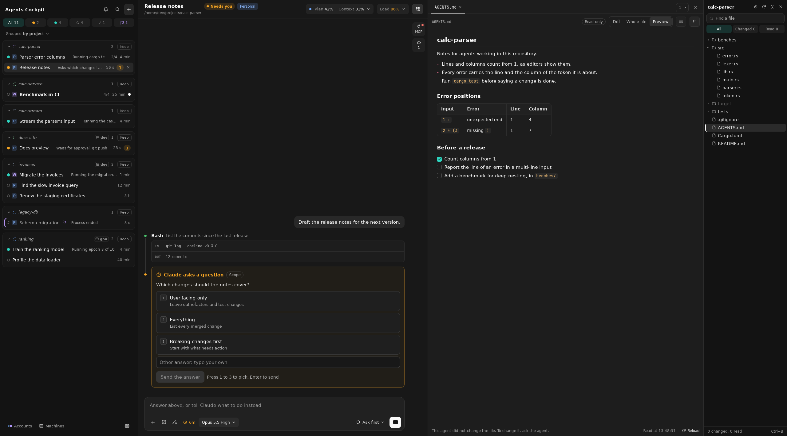

# Agents Cockpit

Orchestrator to control multiple agents over multiple machines and accounts.

|  |  |
| --- | --- |

Main features are:

- Multiple machines (local & remotes)
- Multiple accounts (work, personal, ...)
- Persistent sessions via daemons

On top of that, all the basics and some:

- Steering, questions, plans, MCPs, notifications, ...
- File browsing, diffs, ...
- Quote & reply intuitively
- Messages timeline navigation
- Subagents views

## Install

Download the files from the [releases page](https://github.com/Henauxg/agents-cockpit/releases).

| Your computer | File | Command |
| --- | --- | --- |
| Ubuntu 22.04 or newer, Debian 12 | `agents-cockpit_<version>_amd64.deb` | `sudo apt install ./agents-cockpit_<version>_amd64.deb` |
| Windows 10 or 11 | `agents-cockpit-desktop-<version>-windows-x64.zip`, if the release has one | Unzip the file and run `agents-cockpit-desktop.exe` |
| NixOS, or Linux with Nix | None | See [With Nix](#with-nix) |
| Any other system | None | Build the app: [docs/install-from-source.md](docs/install-from-source.md) |

The `.deb` installs the app (`agents-cockpit-desktop`) and the daemon with its command line (`agents-cockpit`).

Each machine that runs agents also needs Claude Code. Install [Claude Code](https://claude.com/claude-code), then run `claude` once and sign in.

### With Nix

The repository is a Nix flake. Nix builds the app from the release's source on your computer, which takes a few minutes. Nix fetches the source with your SSH key, as `git clone` does. The app, its menu entry and its icon then come with your Nix setup.

To try the app, add it to your user profile. If your Nix does not know `nix profile add`, write `install` in place of `add`.

```sh
nix profile add 'git+ssh://git@github.com/Henauxg/agents-cockpit?ref=refs/tags/v<version>'
```

The profile keeps the version you added. For a new release, remove the app with `nix profile remove agents-cockpit`, then add the new version.

To install the app with the rest of your NixOS configuration, add the flake as an input of your system's flake:

```nix
# In your system's flake.nix
inputs.agents-cockpit.url = "git+ssh://git@github.com/Henauxg/agents-cockpit?ref=refs/tags/v<version>";

# In your NixOS configuration
environment.systemPackages = [ inputs.agents-cockpit.packages.${pkgs.system}.default ];
```

For a new release, change the version in the input, run `nix flake update agents-cockpit`, and rebuild your system. A home-manager configuration takes the same package in `home.packages`.

## Local or remote agents

### On this computer

Start the app. At the first start, the app asks "Where should agents run?":

- **Run agents in this app**: the agents stop when the app closes, and come back at the next start. On Windows, this choice is the only one.
- **Start the background service here** (Linux): the agents keep running after the app closes.

The box "Use this every time" is ticked, so the app keeps your choice. To get the question again at the next start, untick the box.

### On a server over SSH

The server needs Linux on x86_64, SSH access with a key, and Claude Code signed in. For another CPU, build the daemon as [docs/install-from-source.md](docs/install-from-source.md) says.

From the releases page, download `agents-cockpit-<version>-x86_64-linux` and `agents-cockpit.service`. On Ubuntu and Debian, the `.deb` also put the daemon at `/usr/bin/agents-cockpit`.

1. On your computer, copy the two files to the server. Replace `devbox` with the server's name in your SSH config:

   ```sh
   ssh devbox 'mkdir -p ~/.local/bin ~/.config/systemd/user'
   scp agents-cockpit-<version>-x86_64-linux devbox:.local/bin/agents-cockpit
   scp agents-cockpit.service devbox:.config/systemd/user/
   ssh devbox 'chmod +x ~/.local/bin/agents-cockpit'
   ```

2. On the server, start the daemon as a service, and let the service run after you log out:

   ```sh
   systemctl --user daemon-reload
   systemctl --user enable --now agents-cockpit
   loginctl enable-linger "$USER"
   systemctl --user status agents-cockpit
   ```

   Without linger, systemd stops your services when your last session on the server ends, and the agents stop with the services. On some servers, `loginctl enable-linger` needs `sudo`.

3. In the app, open **Machines** at the bottom left, and add the server:
   - **SSH host**: `devbox`, as you type it after `ssh`.
   - **Path of agents-cockpit on the server**: `/home/<you>/.local/bin/agents-cockpit`.

The server's agents show in their own panel in the sidebar.

### Update a server

The app and the daemon must speak the same protocol. If the protocols differ, the server's row in the sidebar says "Runs an older version".

To update the daemon, copy the new daemon over the old one, then restart the service. The restart stops the agents, and the daemon resumes the agents when the daemon starts again. Restart while the agents are idle:

```sh
scp agents-cockpit-<version>-x86_64-linux devbox:.local/bin/agents-cockpit.new
ssh devbox 'chmod +x ~/.local/bin/agents-cockpit.new && mv ~/.local/bin/agents-cockpit.new ~/.local/bin/agents-cockpit && systemctl --user restart agents-cockpit'
```

The app's "Update" button builds the daemon from source on the server. The button works only on a server with Rust and a checkout of this repository, as [docs/development.md](docs/development.md) says.

## When something goes wrong

See [docs/troubleshooting.md](docs/troubleshooting.md).

## How it works

### Claude Code

The daemon runs the official `claude` program without its terminal interface: the daemon writes JSON messages to the program's standard input and reads JSON messages from its standard output. Claude Code runs unmodified and signs in with your own account. The app never sees your credentials.

The app reaches a server with your SSH key, and the daemon opens no network port.

## License

agents-cockpit is under the [Mozilla Public License 2.0](LICENSE). [CONTRIBUTING.md](CONTRIBUTING.md) says how contributions are licensed. To build agents-cockpit or work on it, read [docs/development.md](docs/development.md).
