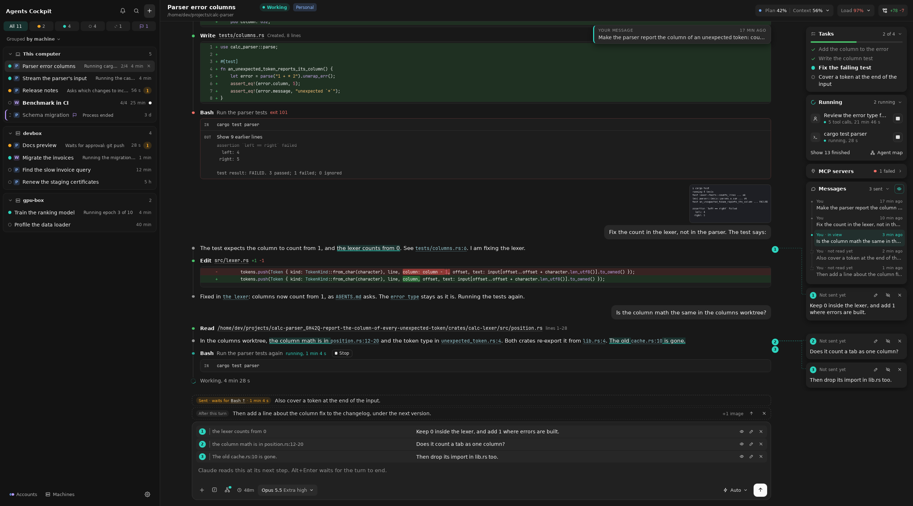
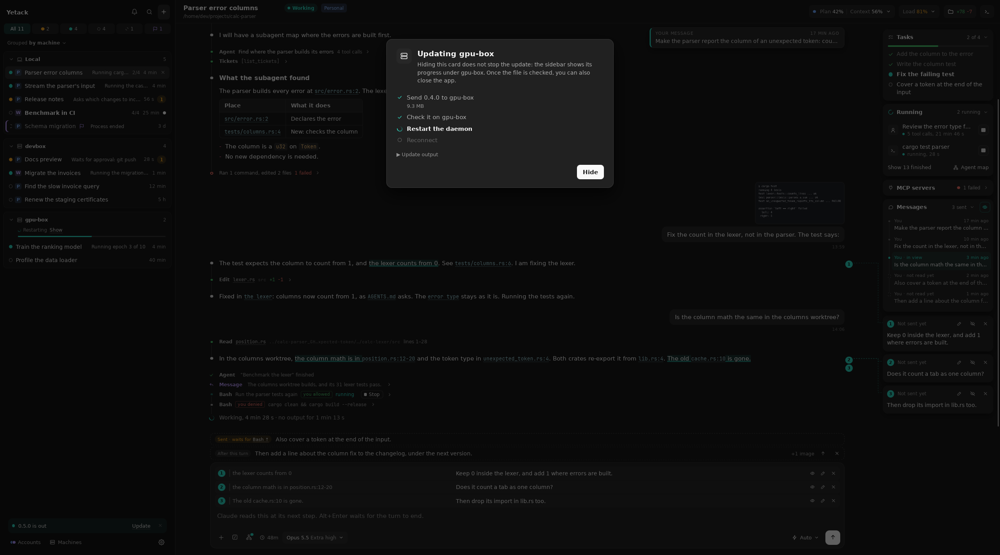

# Yetack (Yet another agents cockpit)

Orchestrator to control multiple agents over multiple machines and accounts.

Features:

- Multiple machines (local & remotes)
- Multiple accounts
- Multiple apps on one daemon
- Persistent sessions via daemons
- Daemons installed and updated from the app
- Steering, questions, plans, approvals, MCPs, notifications
- Terminal, file explorer, find, diffs
- Projects grouping
- Intuitive quotes & replies
- Messages timeline
- Usage, context and machine load at a glance
- Subagent views
- Dictation, transcribed on your computer

## Quick look

|  |  |
| --- | --- |

## Install

Each machine that runs agents needs [Claude Code](https://claude.com/claude-code) installed.

Download the app from the [releases page](https://github.com/Henauxg/yetack/releases):

| Your computer | File |
| --- | --- |
| Ubuntu 22.04 or newer, Debian 12 | `yetack_<version>_amd64.deb`: `sudo apt install ./yetack_<version>_amd64.deb` |
| Fedora, openSUSE | `yetack-<version>-1.x86_64.rpm`: `sudo dnf install` or `sudo zypper install` |
| Any other Linux x86_64 | `yetack-desktop-<version>-x86_64-linux.tar.gz`: see [docs/install.md](docs/install.md#any-other-linux) |
| Windows 10 or 11 | `yetack-desktop-<version>-windows-x64.zip`: unzip it and run `yetack-desktop.exe` |
| NixOS, or Linux with Nix | See [docs/install.md](docs/install.md#with-nix) |
| macOS (untested), or Linux on ARM | Build the app: [docs/install-from-source.md](docs/install-from-source.md) |

The app signals each new release. The Windows app updates itself, and the other installs show the steps to update.

## First start

The app asks where local agents run:

- **In this app**: agents stop when the app closes, and resume when it opens again.
- **In a background service** (Linux only): agents keep running after the app closes.

You can change it later in Settings › Local.

## Add a server

A server needs Linux on x86_64 or ARM, SSH access with a key, and Claude Code installed.

1. In the app, open **Machines** at the bottom left, and click **Add a server**.
2. Type the **SSH host**, as you type it after `ssh`, and leave **Path of yetack on the server** empty.
3. The app finds `yetack` on the server, or offers to install it.
4. The app then says what is left to do on the server, such as turning linger on so the agents keep running after you log out.

You can also list your servers in the app's config file: see [docs/servers.md](docs/servers.md#in-the-config-file).

When a daemon is older than the app, its row in the sidebar offers **Update**. [docs/servers.md](docs/servers.md) has the details, and the steps without the app.

## How it works

The daemon runs the official `claude` program without its terminal interface: the daemon writes JSON messages to the program's standard input and reads JSON messages from its standard output. Claude Code runs unmodified and signs in with your own account. The app never sees your credentials.

The app reaches a server with your SSH key, and the daemon opens no network port.

## Help and contributing

When something goes wrong, see [docs/troubleshooting.md](docs/troubleshooting.md). To build Yetack or work on it, read [docs/development.md](docs/development.md). [CONTRIBUTING.md](CONTRIBUTING.md) says how contributions are licensed.

## License

Yetack is under the [Mozilla Public License 2.0](LICENSE).
